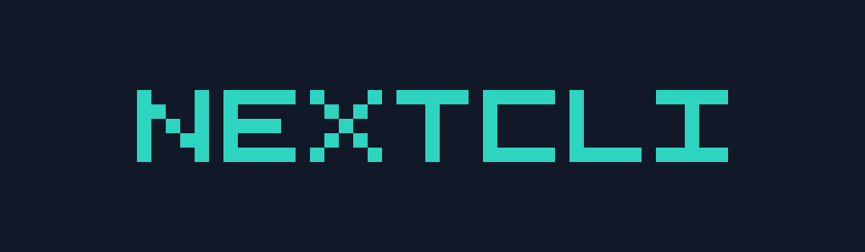

<h1 align="center">NextCLI</h1>

Open-source coding agent. A community continuation of Continue.

  

## What is NextCLI?

NextCLI is a community-maintained continuation of [Continue](https://github.com/continuedev/continue). Continue Dev, Inc. stopped active maintenance of that project. This repository is where maintenance continues, under the [nextcli-dev](https://github.com/nextcli-dev) organization.

NextCLI is a coding agent available as a [CLI](#cli) and a [VS Code extension](#vs-code). It does not ship a JetBrains plugin. In a JetBrains IDE, run the CLI (`cn`) in the terminal. Configuration stays on your machine. There is no NextCLI-hosted hub, sign-in, or telemetry endpoint.

Some identifiers are intentionally unchanged so existing installs keep working. The npm scope is still `@continuedev/*`, the VS Code extension id is still `Continue.continue`, the CLI command is still `cn`, and config still lives in `~/.continue`. See [MAINTAINING.md](./MAINTAINING.md) for why, and for the follow-up list.

## Documentation

Usage and configuration docs are in [`docs/`](./docs). Published pages are intended for [docs.nextcli.dev](https://docs.nextcli.dev).

## VS Code

The extension id has not changed yet, so the marketplace listing is still `Continue.continue` while that listing exists. To build from this repo, package `extensions/vscode` and install the VSIX.

## CLI

The package name is still `@continuedev/cli` and the command is still `cn`.

## Maintenance

[MAINTAINING.md](./MAINTAINING.md) covers how to sync with upstream, which services are off, and what is left for a deeper rebrand.

## License

Apache 2.0. The original work is copyright Continue Dev, Inc. See [LICENSE](./LICENSE) and [NOTICE](./NOTICE).
