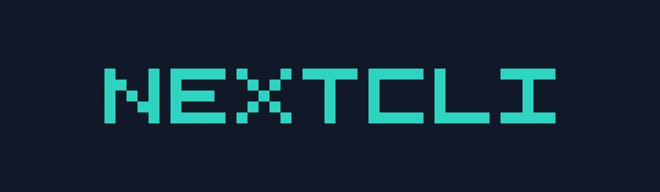
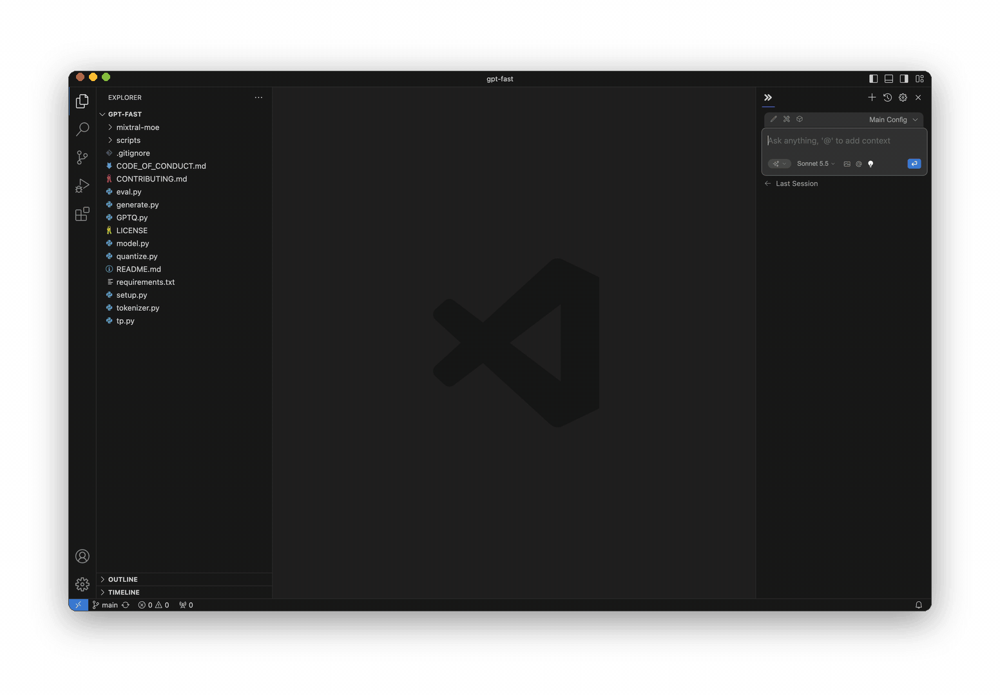
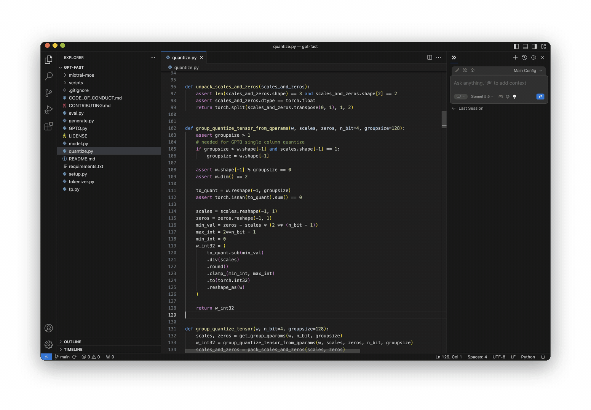
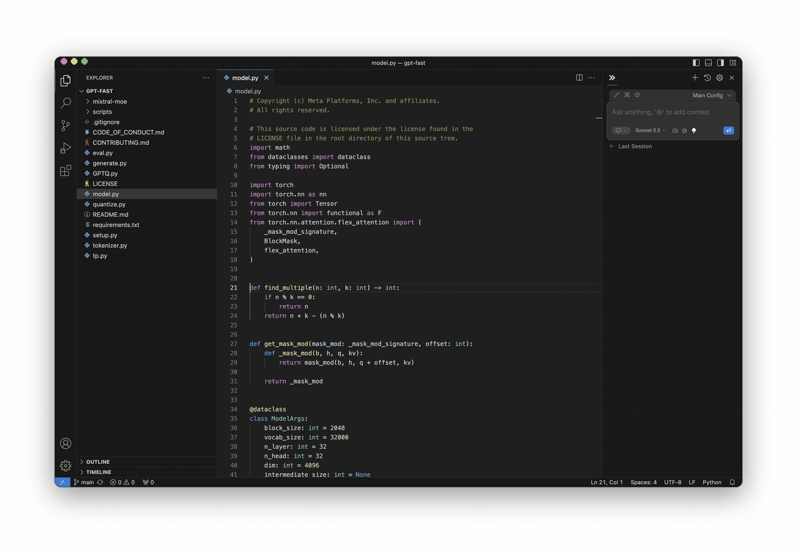
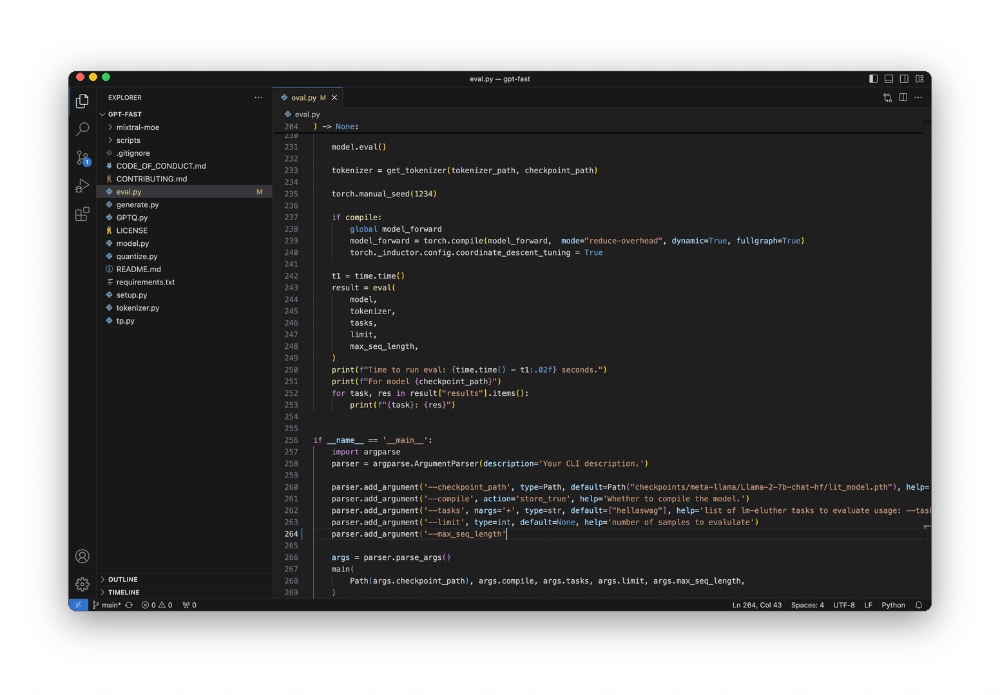

# NextCLI

**The open-source AI coding agent**

NextCLI is a community continuation of [Continue](https://github.com/continuedev/continue) for VS Code. Use your own model and API key. Configuration stays in `~/.continue`. There is no hosted account.

[nextcli.dev](https://nextcli.dev) · [Docs](https://docs.nextcli.dev) · [GitHub](https://github.com/nextcli-dev/nextcli)

## Agent

[Agent](https://docs.nextcli.dev/ide-extensions/agent/quick-start) to work on development tasks together with AI.

## Chat

[Chat](https://docs.nextcli.dev/ide-extensions/chat/quick-start) to ask general questions and clarify code sections.

## Edit

[Edit](https://docs.nextcli.dev/ide-extensions/edit/quick-start) to modify a code section without leaving the current file.

## Autocomplete

[Autocomplete](https://docs.nextcli.dev/ide-extensions/autocomplete/quick-start) to receive inline code suggestions as you type.

## Stable and pre-release versions

Stable versions use even minor numbers (1.6, 1.8). Pre-release versions use odd minor numbers (1.7, 1.9) and are published to the Visual Studio Marketplace only. To try them, open the extension in the Extensions view and choose **Switch to Pre-Release Version**.

## License

Apache 2.0. Original work Copyright Continue Dev, Inc. Continuation Copyright 2026 NextCLI contributors. See [LICENSE.txt](./LICENSE.txt).
